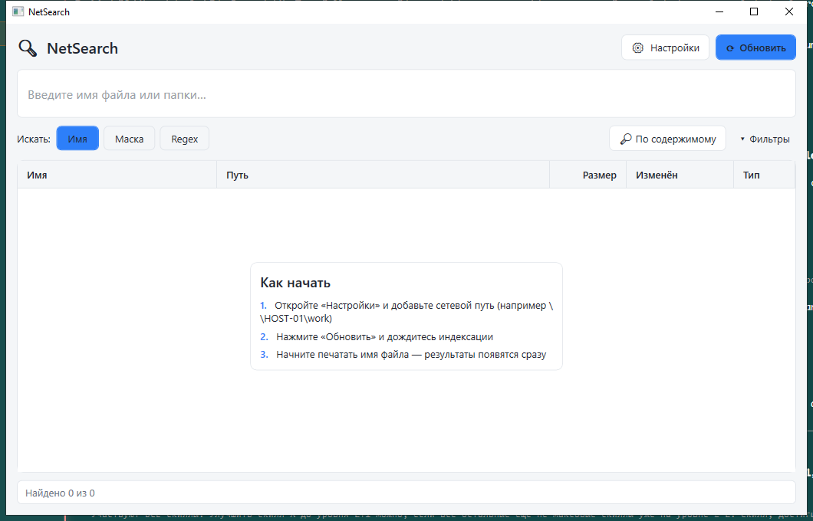

# NetSearch

Fast file and folder search for network (SMB) drives on Windows, in the spirit of WizFile.

[](https://github.com/denfry/NetSearch/actions/workflows/ci.yml)
[](https://github.com/denfry/NetSearch/releases/latest)
[](https://github.com/denfry/NetSearch/releases)
[](LICENSE)

NetSearch indexes the network paths you give it into a local SQLite database
and searches that index instantly: by name (substring, `*?` wildcards, or
regex), with filters for size, date and file type, plus a content search over
the current result set.



> The application interface is currently in Russian only.

## Features

- **Instant search** by name from the local index, with results as you type.
- **Three modes:** substring, wildcard (`*.pdf`, `report_??.xlsx`) and
  regular expressions.
- **Filters:** size (KB/MB/GB), modified-date range, type/extensions, quick
  buttons for PDF / Word / Excel / Photos, files only or folders only.
- **Content search** inside the files already matched by name.
- **Automatic index refresh** at a configurable interval.
- **Local NTFS drives:** when run as administrator, local NTFS roots are read
  directly from the Master File Table and refreshed incrementally from the USN
  change journal; otherwise a parallel directory crawler is used (always the
  case for network paths).
- **Local disks tab:** disk usage with a folder tree and treemap.
- **Cleanup tab:** scans temporary files, browser and thumbnail caches, the
  Recycle Bin, and system/dev caches (Windows Update download cache, crash
  dumps, npm/NuGet/pip caches; some need administrator rights).
- **Single file:** a portable self-contained `.exe`, with no installation and
  no .NET required on the machine.
- **Universal installer:** picks x86, x64 or Arm64 automatically and installs
  for the current user without administrator rights.
- **In-app update:** the app checks GitHub Releases, downloads the installer,
  verifies its SHA-256 checksum, and only then launches the update.

## Installation

**Option 1, installer (recommended):** download `NetSearch-Setup-<version>.exe`
from the [Releases](https://github.com/denfry/NetSearch/releases/latest) page
and run it. Shortcuts and an uninstaller are created automatically.

**Option 2, portable:** download `NetSearch.exe` and run it without
installing.

> Requirements: Windows 10 version 1809 or newer, or Windows 11 (x86, x64 or
> Arm64). The .NET runtime is bundled into the `.exe`. Fast scanning of local
> drives and some cleanup categories require administrator rights.

## Usage

1. Start `NetSearch.exe`.
2. Open **Settings** and add network paths (for example `\\HOST-01\work` or
   `Z:\`, one per line); optionally set the auto-refresh interval.
3. Click **Refresh** to build the index (the first run takes longer).
4. Type in the search box and the list filters immediately. Switch the mode
   (Name / Wildcard / Regex) and expand **Filters** to narrow results.

Right-click a row to open the file, open its folder, or copy the path.

The index and settings are stored in `%LOCALAPPDATA%\NetSearch\`.

## Build from source

Requires the [.NET SDK 9](https://dotnet.microsoft.com/download).

```powershell
dotnet build                                   # build
dotnet test                                    # run tests
dotnet run --project src/NetSearch.App         # run the app
pwsh ./publish.ps1                             # portable x86/x64/Arm64 + dist/NetSearch-Setup-<version>.exe (needs Inno Setup 6.3+)
dotnet run --project tools/IndexBench -c Release -- 100000   # compare index-update algorithms
```

## Project layout

- `src/NetSearch.Core`: indexing (crawler, MFT/USN readers), search, SQLite
  storage, disk usage, cleanup providers and the GitHub update service. No UI
  dependencies.
- `src/NetSearch.App`: the WPF application (MVVM).
- `tests/NetSearch.Core.Tests`: xUnit tests for the core library.
- `tools/IndexBench`: benchmark for index-update algorithms; `tools/IconGen`:
  icon generator.
- `installer/netsearch.iss`: Inno Setup script used by `publish.ps1`.
- `docs/superpowers`: design specs, implementation plans and manual
  verification checklists (for example, MFT scan and USN refresh checks).

## Tech stack

- .NET 9, WPF (`net9.0-windows`)
- MVVM with [CommunityToolkit.Mvvm](https://github.com/CommunityToolkit/dotnet)
- SQLite for the index

## Contributing

Report bugs and suggestions through
[Issues](https://github.com/denfry/NetSearch/issues). Please read
[CONTRIBUTING.md](CONTRIBUTING.md) before opening a pull request.

## License

[MIT](LICENSE) (c) denfry
